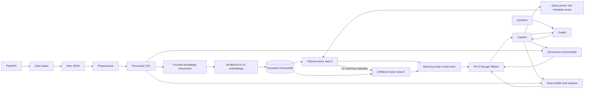

# Engineering Challenges

This document describes the engineering constraints represented by the current repository. It separates implemented behavior from proposed work; performance and quality improvements are not presented as measured unless the repository contains a measurement.

## System at a Glance

## Engineering Challenges

### Data Engineering: Turning PokéAPI Resources into a Reusable Dataset

#### Problem

The application needs related Pokémon, species, move, and evolution data in a form that both document generation and structured recommendation code can use.

#### Why it happened

PokéAPI exposes linked JSON resources rather than one local, query-ready table. Collection can also fail transiently, and repeatedly downloading completed resources is wasteful.

#### Impact

Serving and indexing depend on successfully collected and processed source data. Missing or inconsistent records would affect both knowledge documents and recommendation results.

#### Solution Implemented

The data loader saves raw resources and includes retry/resume behavior. The preprocessor creates separate CSVs for Pokémon, species, moves, and evolution chains; later stages consume these processed files.

#### Why this solution was chosen

The raw-to-processed boundary keeps API-specific handling out of retrieval and recommendation code, while CSVs remain inspectable and easy to regenerate for this project’s scale.

#### Future Improvements

Add dataset snapshots, schema-version checks, provenance timestamps, and validation reports for missing foreign keys or incomplete resources.

### Knowledge Base Design: Representing Several Kinds of Pokémon Facts

#### Problem

A single record must support questions about identity, typing, abilities, statistics, physical attributes, moves, and evolution without making every retrieved passage overly broad.

#### Why it happened

These questions refer to different fields and relationships. A large composite record would mix information that is irrelevant to many queries.

#### Impact

Poorly scoped records increase irrelevant context and make it harder for the generator to answer a narrow question from the right fact.

#### Solution Implemented

The document generator emits focused Pokémon documents for overview, types, abilities, stats, physical information, and learnable moves, alongside separate move and evolution-chain documents. Each record carries metadata such as `document_type`, and Pokémon records also carry Pokémon and generation fields.

#### Why this solution was chosen

Focused records are small, human-readable, and compatible with both vector search and metadata filtering. The generated JSON files also provide an inspectable intermediate artifact before embedding.

#### Future Improvements

Add schema versioning, explicit source URLs, update timestamps, and relationship metadata to move and evolution documents.

### Document Chunking Strategy: Choosing a Useful Retrieval Unit

#### Problem

The system needs chunks small enough to retrieve by question intent but large enough to preserve the facts needed for an answer.

#### Why it happened

Arbitrary token-based splitting can separate a label from its value, while one document per entire Pokémon can bury a type or height fact among unrelated material.

#### Impact

Chunk boundaries influence retrieval precision and how much unrelated context reaches Phi-3.

#### Solution Implemented

The current generator creates semantic sections rather than splitting by a generic token count. It produces six focused Pokémon document types and separate move and evolution-chain records.

#### Why this solution was chosen

The source data already has natural field groups, so those groups produce understandable, stable chunks without an additional parsing framework.

#### Future Improvements

Measure chunk length distributions and retrieval quality. Split unusually long move or evolution records only when evaluations show that their size harms retrieval.

### Metadata Design: Making Records Filterable

#### Problem

The retriever needs metadata fields that identify a Pokémon, its generation, and the kind of knowledge represented by a document.

#### Why it happened

Vector similarity alone does not enforce a requested subject or category. Metadata must also satisfy ChromaDB’s scalar-value constraints.

#### Impact

Inconsistent values prevent filters from matching; missing values limit which records can be narrowed safely.

#### Solution Implemented

Pokémon documents use fields including `pokemon`, `pokemon_id`, `generation`, and `document_type`. Move and evolution documents use their resource-specific identifiers and document type. The vector store converts list metadata to scalar text before insertion.

#### Why this solution was chosen

The fields align with actual query intents and ChromaDB filtering while retaining source-specific identifiers. No separate metadata database is needed.

#### Future Improvements

Validate metadata schemas before indexing and add Pokémon/generation fields to evolution-chain documents so they can be filtered consistently with Pokémon records.

### Embedding Model Selection: Local Semantic Search at Portfolio Scale

#### Problem

The project needs document and query vectors that share a representation and can be generated locally without a hosted embedding service.

#### Why it happened

Semantic search depends on compatible vectors and adds model-download, memory, and startup costs to a local application.

#### Impact

Model choice affects retrieval relevance, storage size, and local resource use. The repository does not contain a benchmark comparing models.

#### Solution Implemented

SentenceTransformers uses `all-MiniLM-L6-v2` for both documents and queries. Its configured output dimension is 384, and the model is cached within the process.

#### Why this solution was chosen

It provides a compact local embedding path with a single model dependency and no separate hosted embedding API. The choice is pragmatic for the dataset size, not a measured claim that it is optimal.

#### Future Improvements

Create a Pokémon question set and compare candidate embedding models using retrieval metrics such as Recall@K and MRR, along with memory and latency measurements.

### Vector Database Design: Persistent Local Indexing

#### Problem

Document vectors and their content/metadata must remain available between application runs, without introducing a separate database service.

#### Why it happened

Re-embedding the full corpus at each startup would add avoidable model work, and in-memory storage would lose the index when the process exits.

#### Impact

Index persistence makes local runs practical, but index lifecycle and freshness must be managed when source documents change.

#### Solution Implemented

ChromaDB’s `PersistentClient` stores the `pokemon_knowledge` collection under the configured local database path. The vector-store stage skips IDs already present.

#### Why this solution was chosen

Persistent ChromaDB keeps the project self-contained and supports nearest-neighbor queries with metadata filters using the current collection scale.

#### Future Improvements

Add explicit upsert/delete reconciliation and collection versioning. The current ID check does not update stale records or remove documents no longer present in source data.

### Retrieval Accuracy: Selecting Context That Answers the Question

#### Problem

Top-K nearest-neighbor search can return semantically related but factually irrelevant documents, especially when the collection contains several document categories.

#### Why it happened

Embedding similarity is a relevance signal, not a guarantee that a result contains the requested field. The current pipeline has no cross-encoder reranker or measured evaluation set.

#### Impact

Irrelevant context can reduce answer accuracy and consume the prompt budget. The configured `TOP_K` is a fixed default rather than an evaluated optimum.

#### Solution Implemented

The retriever embeds each query with the document model, searches ChromaDB, and returns up to `TOP_K` records with metadata and a score derived from L2 distance. Metadata-aware intent routing further restricts many searches before nearest-neighbor ranking.

#### Why this solution was chosen

It retains a simple, explainable retrieval pipeline and avoids hiding retrieval behavior inside a higher-level chain abstraction.

#### Future Improvements

Build labeled question/document pairs, measure Recall@K and answer faithfulness, then tune `TOP_K` and evaluate hybrid search and reranking.

### Metadata-Aware Retrieval: Narrowing Search Before Ranking

#### Problem

Questions such as “What type is Pikachu?” should not compete with unrelated Pokémon, move, and evolution documents in the same vector search.

#### Why it happened

Semantic similarity across the full collection does not guarantee a matching entity or document category.

#### Impact

Category and Pokémon filtering reduce irrelevant candidates before semantic ranking. Filters also make queries sensitive to metadata completeness.

#### Solution Implemented

`query_parser.py` detects known Pokémon names, document intent, and generation. `metadata_router.py` builds ChromaDB `where` conditions; the retriever applies them before vector search and retries with the existing unfiltered search when the filtered result is empty. Evolution documents have only `chain_id` and `document_type`, so a recognized species is routed through its evolution-chain ID instead of nonexistent Pokémon or generation fields.

#### Why this solution was chosen

ChromaDB filtering limits candidates without changing the embedding model, document generator, or API contract. The empty-result fallback preserves broad semantic retrieval when the metadata route has no match.

#### Future Improvements

Add entity/category filters to all document families, record routing decisions for diagnostics, and evaluate parser accuracy and fallback frequency on real questions.

### Prompt Engineering: Keeping the Generation Step Grounded

#### Problem

The language model must turn retrieved data into a concise answer while distinguishing the user’s question from the reference context.

#### Why it happened

Models can answer from prior training or treat text in retrieved documents as instructions unless the prompt defines the context’s role.

#### Impact

Poor prompt boundaries can produce unsupported details or verbose responses even when retrieval returned relevant data.

#### Solution Implemented

The prompt builder manually includes the question and retrieved titles/content, treats context as reference data rather than instructions, requests a concise complete answer, and supplies a fixed fallback phrase when the context lacks the answer.

#### Why this solution was chosen

Manual prompt construction is lightweight and makes the actual model input explicit for debugging and interview discussion.

#### Future Improvements

Add prompt regression cases, explicit citations to retrieved documents, and token-budget-aware context selection.

### Hallucination Prevention: Handling Missing Evidence

#### Problem

When retrieval returns no useful evidence, the model may still produce a plausible answer.

#### Why it happened

Local LLMs have learned general facts and may confidently answer questions not supported by this generation-scoped knowledge base.

#### Impact

Unsupported answers are especially problematic for a knowledge assistant whose value depends on traceability to its data.

#### Solution Implemented

The prompt instructs the model to use retrieved context only and provide a fixed “not found” response when the context is insufficient. If retrieval itself is empty, the RAG layer returns the same fallback without invoking the model.

#### Why this solution was chosen

It makes evidence absence an explicit part of the request path and avoids paying for generation when there is no context.

#### Future Improvements

Test abstention behavior with adversarial and out-of-scope questions, return source document references, and evaluate faithfulness separately from answer fluency.

### Phi-3 Local LLM Integration: Balancing Capability and Local Constraints

#### Problem

The answer generator must run on a developer machine and communicate with a separately managed local model server.

#### Why it happened

The LLM has independent model-download, process-availability, memory, and request-latency requirements. FastAPI can start even when Ollama is unavailable.

#### Impact

The RAG request depends on Ollama being reachable and the configured model being installed; startup success alone does not prove generation readiness.

#### Solution Implemented

The configured default is `phi3:latest`, invoked through LangChain’s `ChatOllama` integration at the configured Ollama base URL. The LangChain dependency is limited to the chat integration; retrieval and prompt assembly remain application code.

#### Why this solution was chosen

Phi-3 provides a local inference option aligned with the project’s resource-conscious portfolio setup. The repository does not include a comparative quality or latency benchmark establishing it as the best model.

#### Future Improvements

Add readiness diagnostics for the Ollama server and model, tune generation settings against a fixed evaluation set, and document machine resource requirements from measured runs.

### Recommendation System Design: Use Structured Facts for Structured Questions

#### Problem

Requests for high stats, specific types, abilities, moves, or legendary status are better expressed as constraints over fields than as similarity to free-text documents.

#### Why it happened

Embeddings do not guarantee exact numerical comparisons or exact categorical matches.

#### Impact

Using vector search alone for recommendations could return plausible-sounding but constraint-violating Pokémon.

#### Solution Implemented

The recommender loads processed Pokémon and species records, parses supported constraints, filters/ranks structured fields, and asks the LLM to explain selected results using supplied data. Rule-based reasons are available when generation fails.

#### Why this solution was chosen

Structured ranking keeps selection criteria inspectable and separates recommendations from the RAG retriever. The LLM is used for explanation rather than deciding whether a hard data constraint is satisfied.

#### Future Improvements

Expand the query grammar, add a transparent scoring breakdown, and evaluate ranking relevance using curated recommendation requests.

### Team Builder Design: Producing Six Members with Explainable Coverage

#### Problem

A team request combines constraints such as generation, theme, anchor Pokémon, and legendary exclusions, while asking for roles and offensive/defensive coverage.

#### Why it happened

Team construction is a multi-objective selection problem; maximizing one stat or type can create a team with repeated weaknesses or duplicated roles.

#### Impact

Heuristic teams are explainable and fast but should not be mistaken for competitive simulation or an optimizer over battle outcomes.

#### Solution Implemented

The team builder selects six records from the configured dataset using stat-, type-, role-, and theme-based heuristics. It calculates type weaknesses/resistances and emits a reason for each selection; the LLM may phrase explanations but does not choose members.

#### Why this solution was chosen

The deterministic selection rules are easier to inspect than asking an LLM to invent a roster, and they reuse the structured dataset already used by recommendations.

#### Future Improvements

Model move sets, ability interactions, generation-specific type charts, selectable battle formats, and team-level optimization with explicit weights.

### Backend Architecture: Keeping RAG and Structured Tools Separate

#### Problem

The application serves question answering, recommendations, team construction, and analysis while keeping their data paths understandable.

#### Why it happened

RAG depends on embeddings and a vector store; recommendations and matchup analysis depend on exact structured fields. One shared retrieval abstraction would obscure that difference.

#### Impact

Separation reduces coupling, but it means each workflow has distinct input validation, error paths, and tests to maintain.

#### Solution Implemented

Backend modules separate data loading, preprocessing, document generation, embedding, vector storage, retrieval, prompts, RAG orchestration, recommendation, team building, and team analysis. FastAPI exposes the existing `/ask` route and dedicated structured-feature routes.

#### Why this solution was chosen

The modules follow the project’s lightweight, single-responsibility guidance without introducing a dependency-injection framework or a second service.

#### Future Improvements

Add service-level tests for endpoint contracts and startup/shutdown diagnostics while keeping data preparation and serving concerns distinct.

### API Design: Stable JSON Contracts Across Different Workflows

#### Problem

The Gradio client needs predictable request and response shapes for model-generated answers and structured feature results.

#### Why it happened

The workflows have different payloads and failure conditions, and invalid inputs should not become opaque server errors.

#### Impact

Typed contracts make integration clearer, but response changes must be coordinated with the UI and documented examples.

#### Solution Implemented

Pydantic models validate request fields; FastAPI exposes separate endpoints for `/ask`, `/recommend`, `/team`, and `/analyze-team`, plus root and health routes. The Gradio feature tabs render structured API results as Markdown while keeping JSON internal to the request handlers.

#### Why this solution was chosen

Separate endpoints preserve explicit contracts and allow recommendation work to evolve without changing the RAG endpoint.

#### Future Improvements

Add API contract tests, consistent machine-readable error codes, and versioning if external clients depend on the API.

### Frontend UX: Making Structured Results Readable

#### Problem

Nested JSON is useful for APIs but difficult to scan in a conversational interface.

#### Why it happened

Recommendations, teams, and analysis contain repeated records and summary fields that need hierarchy and emphasis.

#### Impact

Raw JSON pushes interpretation work onto users and hides the reasoning behind a selection.

#### Solution Implemented

Gradio has separate tabs for Ask Pokémon, Recommend Pokémon, Team Builder, and Team Analyzer. Recommendation responses are converted to Markdown with names, types, roles, and reasons; team and analyzer responses are rendered with headings and summaries. The existing dark theme is retained.

#### Why this solution was chosen

Markdown supports readable hierarchy without adding a frontend framework or changing backend response models.

#### Future Improvements

Add browser-level accessibility and responsive-layout checks, loading/error states per workflow, and optional expandable evidence details.

### Performance: Avoiding Repeated Model and Index Work

#### Problem

Embedding models and vector indexes impose startup and memory costs, while recommendation calls repeatedly need access to processed data.

#### Why it happened

Model initialization and filesystem loading are more expensive than ordinary in-process filtering.

#### Impact

Cold starts and memory requirements can dominate local use; the repository does not publish benchmark measurements.

#### Solution Implemented

The embedding model and recommendation catalog are cached within the process. ChromaDB persists vectors between runs, and data preparation is run separately from API serving.

#### Why this solution was chosen

Process-local caches and a persistent local index reduce repeated work without adding cache infrastructure or a managed database.

#### Future Improvements

Measure cold/warm startup, embedding time, filtered/unfiltered query time, and memory use; add cache invalidation tied to dataset/index versions.

### Latency: Separating Retrieval Cost from Generation Cost

#### Problem

An end-to-end answer includes query embedding, vector search, and LLM generation, each with different latency characteristics.

#### Why it happened

Local inference runs on the developer’s hardware, and initial model loading may differ substantially from subsequent requests.

#### Impact

Without stage-level measurements, users cannot tell whether a slow response comes from embedding, ChromaDB, Ollama startup, or token generation.

#### Solution Implemented

The architecture keeps retrieval and LLM calls in separate modules, which makes separate timing instrumentation possible. No latency metrics are currently recorded or claimed.

#### Why this solution was chosen

Keeping stages explicit maintains a debuggable pipeline and avoids adding monitoring dependencies before there is a deployment target.

#### Future Improvements

Record per-stage timings, model warm-up status, generation token counts, and percentile latency under a reproducible local workload.

### Scalability: Recognizing the Limits of a Local Single-Process Design

#### Problem

The current setup is designed around one local dataset, one persistent collection, and a local model endpoint rather than concurrent multi-user service.

#### Why it happened

The project prioritizes a compact, explainable learning architecture over distributed infrastructure.

#### Impact

Concurrent model requests, index growth, and multi-instance access to local persistent files have not been load-tested or designed as a production service.

#### Solution Implemented

The project uses a persistent local ChromaDB collection and a single FastAPI application, with data preparation performed as separate commands. No horizontal-scaling guarantees are implemented.

#### Why this solution was chosen

It matches the repository’s portfolio scope and keeps operational dependencies low while retaining clear module boundaries.

#### Future Improvements

Load-test representative workloads, define concurrency limits, and choose hosted or replicated vector/model services only when measured needs require them.

### Security: Defining the Local Development Boundary

#### Problem

An API that accepts user questions and returns model output needs input validation and safe operational defaults, even when intended for local use.

#### Why it happened

Local interfaces can still be exposed accidentally, and model/context inputs may be untrusted.

#### Impact

The current repository is not an authenticated multi-user service. It does not implement user authentication, rate limiting, or a production secrets-management flow; debug error responses can expose exception details.

#### Solution Implemented

Pydantic validates API request shapes and required values, and the default service/model addresses are loopback/local. These are development safeguards, not a complete security boundary.

#### Why this solution was chosen

The implementation keeps local setup simple but explicitly leaves production access control to a deployment-specific layer.

#### Future Improvements

Add authentication and authorization, rate limits, request-size bounds, secret management, sanitized production errors, and network exposure guidance before public deployment.

### Deployment Considerations: Coordinating API, UI, Model, and Index

#### Problem

The user-facing application depends on a running API, an available ChromaDB directory, processed data for structured features, and an Ollama service/model for generation.

#### Why it happened

These components are separate processes or persisted assets, and successful startup of one does not guarantee readiness of the others.

#### Impact

Local execution requires environment configuration and coordinated process startup; a fresh checkout may lack a populated vector index.

#### Solution Implemented

Configuration is loaded from `.env` with defaults, FastAPI and Gradio run as separate commands, and data/index preparation is documented as an explicit pipeline. The Gradio UI reports request errors to users.

#### Why this solution was chosen

Separate commands keep the operational model transparent and allow each component to be replaced or diagnosed independently.

#### Future Improvements

Provide Docker Compose, health/readiness checks that include Ollama and ChromaDB, reproducible data/index setup, deployment secrets, and a documented backup/rebuild strategy.

## Engineering Decisions

### Why RAG Instead of Fine-Tuning

Pokémon facts are structured and updateable data. RAG keeps source facts outside model weights, allows the indexed knowledge to be rebuilt, and provides retrieved context at answer time. Fine-tuning would not by itself provide reliable access to the current dataset or precise field lookup. Fine-tuning could still be evaluated for response style, but it is not needed to store this project’s facts.

### Why ChromaDB

The project needs persistent vector search with metadata filters and a small local operational footprint. ChromaDB provides a local persistent collection without requiring a separate database server. The current design is suitable for the checked-in dataset scale; it does not establish production multi-writer or large-scale performance characteristics.

### Why FastAPI

FastAPI exposes explicit REST endpoints, validates payloads through Pydantic, and supplies interactive API documentation. It separates client presentation from retrieval and recommendation modules while keeping the backend in one application.

### Why Phi-3

Phi-3 is the configured local model (`phi3:latest`) for this project. It fits the goal of demonstrating a compact local LLM integration. No repository benchmark proves it is more accurate or faster than other available models, so model quality should be treated as an evaluation question.

### Why Ollama

Ollama provides a local model-serving endpoint that `ChatOllama` can call. It keeps model serving outside the RAG code and avoids requiring a hosted inference provider for local development. The application still depends on the Ollama service and downloaded model being available.

### Why SentenceTransformers

SentenceTransformers generates document and query embeddings locally with the same configured model. This avoids a hosted embedding dependency and makes the retrieval representation explicit. `all-MiniLM-L6-v2` is the current configured model; alternatives require retrieval evaluation before replacement.

### Why Metadata Filtering

Pokémon identity, generation, and document category are known attributes that vector similarity alone cannot enforce. Applying ChromaDB filters before ranking reduces the candidate set for clear intents, while unfiltered search remains as a fallback when filters return nothing.

### Why Rule-Based Recommendations

Type, stat, ability, generation, and legendary constraints should be checked against structured fields. Rules provide inspectable selection criteria; the LLM explains selected records rather than choosing them. This avoids using semantic similarity as a substitute for exact constraints.

### Why Local Inference

Local inference demonstrates an end-to-end RAG path without sending prompts to a hosted LLM provider. It also puts model availability, hardware, and latency under the developer’s control. PokéAPI collection and initial dependency/model downloads still require network access, so the whole setup is not inherently offline.

## Lessons Learned

### What Worked Well

- Keeping raw JSON, processed CSVs, generated documents, and vectors as visible pipeline stages makes data lineage inspectable.
- Separating RAG from structured recommendations avoids forcing exact stat/type constraints through embedding search.
- Focused documents plus metadata filters give retrieval both semantic flexibility and exact categorical scoping.
- Keeping prompt construction manual makes the context and abstention instructions straightforward to inspect.
- A JSON API contract lets Gradio present readable Markdown without changing the backend data contract.

### Biggest Engineering Improvements

- Add automated retrieval and answer evaluations before tuning embeddings, `TOP_K`, or prompts.
- Add vector-index versioning and stale-record reconciliation.
- Measure per-stage latency and model readiness.
- Add generation-aware metadata to evolution-chain records and improve metadata coverage across all document types.
- Replace heuristic team coverage with generation-specific move and battle mechanics when competitive accuracy is required.

### Bottlenecks Discovered

- Local LLM generation and model initialization are likely to dominate interactive latency, but the repository has no measured breakdown.
- Query quality depends on metadata coverage and the correctness of intent/entity parsing.
- ChromaDB indexing skips existing IDs; changes to source content need an explicit rebuild or index reconciliation process.
- The retriever uses a fixed `TOP_K` and has no reranker or labeled retrieval evaluation set.

### Trade-offs

- Local control and privacy come with machine-specific memory and latency constraints.
- Semantic document retrieval is flexible but less exact than direct structured-field lookup.
- Metadata filtering improves focus when metadata exists but cannot filter evolution records by fields they do not store.
- Simple rules are explainable but do not model a complete competitive battle simulator.
- A single-process application is easy to run but has no demonstrated horizontal-scaling guarantees.

### What Would Change in Version 2

- Add a labeled evaluation set covering all document types, entity variants, ambiguity, and out-of-scope questions.
- Use hybrid lexical/vector search and evaluate cross-encoder reranking against the baseline.
- Version generated documents and collections, then reconcile updates and deletions rather than skipping all existing IDs.
- Add explicit generation and species identifiers to every applicable document, including evolution chains.
- Add generation-specific move/type mechanics and make team-building constraints configurable.
- Provide containerized setup, readiness checks, and hardened production configuration only after defining a deployment target.

### Production Improvements

- Add authentication, authorization, rate limiting, input-size limits, sanitized errors, and secrets management.
- Add health/readiness probes for FastAPI, ChromaDB, and Ollama; separate liveness from dependency readiness.
- Add observability for retrieval filters, fallback frequency, retrieval scores, stage timings, model errors, and token use without logging sensitive prompt content by default.
- Establish backups and repeatable recovery for the persistent index and source datasets.
- Load-test concurrency and choose a deployment architecture from measured capacity requirements.

### Technical Interview Talking Points

- Explain why exact recommendation constraints use structured data while open-ended knowledge questions use RAG.
- Trace one question from intent/entity parsing through ChromaDB `where`, vector ranking, prompt construction, and local generation.
- Discuss why the filtered search falls back to unfiltered semantic search and what metadata gaps remain.
- Describe the trade-off between semantic chunking and generic token-based chunks.
- Explain how to evaluate retrieval using Recall@K/MRR and generation using faithfulness and abstention tests.
- Be explicit that team selection is heuristic, the type chart needs generation-specific validation, and no latency benchmark is currently published.
