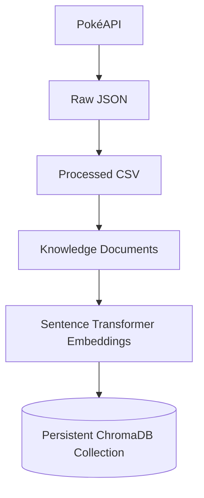
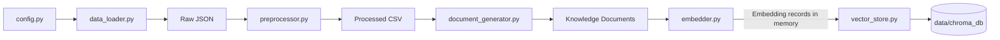

# Pokedex AI

## Overview

Pokedex AI is a local Pokémon knowledge-data pipeline. It collects generation-scoped data from PokéAPI, converts raw JSON into structured CSV files and knowledge documents, generates vector embeddings, and stores those vectors in a persistent ChromaDB collection.

The current implementation covers data preparation and vector indexing. It does not yet provide an end-user question-answering workflow.

## Features

- Generation-scoped PokéAPI downloads with retries and resume support.
- CSV preprocessing for Pokémon, species, moves, and evolution chains.
- Natural-language knowledge documents for Pokémon, moves, and evolution chains.
- Batched embeddings generated with `all-MiniLM-L6-v2`.
- Persistent ChromaDB collection with duplicate-ID protection.

## Tech Stack

- Python 3.12
- PokéAPI, Requests, and tqdm
- pandas
- Sentence Transformers
- ChromaDB
- python-dotenv

## Project Architecture



### Module Interaction



## Folder Structure

```text
pokedex-ai-rag/
├── AGENTS.md
├── .env.example
├── .gitignore
├── README.md
├── requirements.txt
├── backend/
│   ├── app.py
│   ├── config.py
│   ├── data_loader.py
│   ├── preprocessor.py
│   ├── document_generator.py
│   ├── embedder.py
│   ├── vector_store.py
│   ├── llm.py
│   ├── rag.py
│   ├── recommender.py
│   └── retriever.py
├── frontend/
│   └── app.py
└── data/
	├── raw/
	│   ├── pokemon/
	│   ├── species/
	│   ├── moves/
	│   └── evolution_chains/
	├── processed/
	│   ├── pokemon.csv
	│   ├── species.csv
	│   ├── moves.csv
	│   └── evolution_chains.csv
	├── documents/
	│   ├── pokemon_documents.json
	│   ├── move_documents.json
	│   └── evolution_documents.json
	└── chroma_db/
```

The files `llm.py`, `rag.py`, `recommender.py`, `retriever.py`, and
`frontend/app.py` are present as placeholders. `backend/app.py` currently
exposes only welcome and health endpoints. These modules are not part of the
data pipeline shown above.

## Data Pipeline

Pokémon species IDs come from the selected PokéAPI generation. The pipeline downloads the corresponding species and Pokémon records, then follows references in those records to find the required moves and evolution chains.

The preprocessor creates one CSV per resource type. The document generator combines Pokémon and species data and creates separate document sets for Pokémon, moves, and evolution chains. The embedder converts document content into vectors in batches. The vector-store module passes those vectors and their source data to ChromaDB.

## Installation

Use Python 3.12 and install the dependencies from the project root:

```powershell
python -m venv .venv
.\.venv\Scripts\Activate.ps1
python -m pip install -r requirements.txt
```

## Project Setup

Create the local environment file from the example:

```powershell
Copy-Item .env.example .env
```

Edit `TARGET_GENERATION` to select the generation for data collection. The other environment settings and their current usage are listed below.

## Environment Variables

| Variable | Example | Current use |
| --- | --- | --- |
| `TARGET_GENERATION` | `1` | Selects the generation used by the data loader. |
| `POKEAPI_BASE_URL` | `https://pokeapi.co/api/v2` | Base URL used for API requests. |
| `POKEAPI_TIMEOUT` | `10` | Request timeout in seconds. |
| `POKEAPI_MAX_RETRIES` | `3` | Maximum attempts for a failed API request. |
| `EMBEDDING_MODEL` | `all-MiniLM-L6-v2` | Defined in config; the embedder currently uses its `MODEL_NAME` constant. |
| `CHROMA_DB_PATH` | `data/chroma_db` | Defined in config; the vector-store module currently uses this project-relative path directly. |
| `TOP_K` | `5` | Defined in config; not used by the current pipeline. |
| `OLLAMA_MODEL` | `llama3` | Defined in config; not used by the current pipeline. |

## Running the Project

Run each stage from the project root, in order:

```powershell
python -m backend.data_loader
python -m backend.preprocessor
python -m backend.document_generator
python -m backend.embedder
python -m backend.vector_store
```

The embedder command reports the embedding summary without saving vectors. The vector-store command generates embeddings again and persists them in ChromaDB.

## Data Collection

`backend/data_loader.py` starts at the PokéAPI Generation endpoint. It saves each resource as an individual JSON file under `data/raw/`, skips existing valid files, and retries failed requests. Move IDs are collected from Pokémon data; evolution-chain IDs are collected from species data. Only referenced moves and chains are downloaded.

## Data Preprocessing

`backend/preprocessor.py` reads the raw JSON files and writes `pokemon.csv`, `species.csv`, `moves.csv`, and `evolution_chains.csv` to `data/processed/`. It extracts the project’s selected fields, normalizes text, selects English descriptions/effects, flattens evolution stages, and removes duplicate rows.

## Knowledge Document Generation

`backend/document_generator.py` merges Pokémon and species rows by ID and creates one JSON document per Pokémon. It also creates one document per move and evolution chain. The files are written to `data/documents/` with an ID, resource type, title, natural-language content, and metadata.

## Embedding Generation

`backend/embedder.py` loads the three knowledge-document files and embeds each document’s `content` using `all-MiniLM-L6-v2` with a batch size of 32. The resulting records keep their IDs, content, and metadata with each vector. Running this stage alone keeps vectors in memory; it does not save them.

## Vector Database (ChromaDB)

`backend/vector_store.py` uses ChromaDB’s `PersistentClient` at `data/chroma_db/` and creates or opens the `pokemon_knowledge` collection. It checks IDs before insertion and skips records already in the collection. List-valued metadata is converted to comma-separated text for storage.

## Current Project Workflow

1. Collect Generation I resources from PokéAPI.
2. Convert raw JSON into four processed CSV datasets.
3. Generate Pokémon, move, and evolution-chain knowledge documents.
4. Generate document-content embeddings.
5. Store the vectors and associated records in the persistent collection.

## Example Project Output

The current local collection contains 821 records. A first indexing run for the current datasets reports:

```text
Collection: pokemon_knowledge
Pokemon Documents: 151
Move Documents: 592
Evolution Documents: 78
Total Indexed: 821
Collection Count: 821
Indexing Complete.
```

On a later run, `Total Indexed` may be zero because existing IDs are skipped; `Collection Count` reports the stored total.

## Project Statistics

The following snapshot was calculated from the current local raw files, CSVs, knowledge documents, source tree, and persistent collection on 2026-10-15. Generated data and source counts can differ on another checkout or after rerunning the pipeline.

| Category | Metric | Value |
| --- | --- | ---: |
| Dataset | Pokémon downloaded | 151 |
| Dataset | Species downloaded | 151 |
| Dataset | Unique moves | 592 |
| Dataset | Evolution chains | 78 |
| Knowledge base | Pokémon documents | 151 |
| Knowledge base | Move documents | 592 |
| Knowledge base | Evolution documents | 78 |
| Knowledge base | Total knowledge documents | 821 |
| Embeddings | Model | `all-MiniLM-L6-v2` |
| Embeddings | Dimension | 384 |
| Vector store | Collection | `pokemon_knowledge` |
| Vector store | Total indexed documents | 821 |
| Repository | Python source files | 12 |
| Repository | Backend modules | 11 |
| Repository | Approximate Python source lines | 1,151 |
| Repository | Implemented project phases | 6 |

## Future Improvements

- Add a question-time similarity search workflow over the stored collection.
- Connect generated context to an Ollama chat model through LangChain.
- Expand the minimal FastAPI application beyond its current root and health endpoints.
- Build a Gradio interface for interacting with the project.
- Implement and connect the Pokémon recommendation module.

## License

No `LICENSE` file is currently present. The project’s reuse and distribution terms have not been specified.