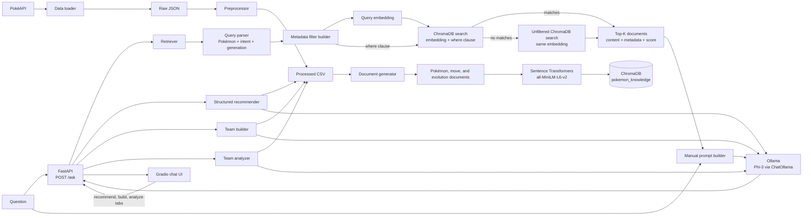

# PokéDex AI


PokéDex AI is a local Pokémon assistant with two separate paths: RAG answers questions from retrieved knowledge documents, while recommendations and team tools use processed Pokémon stats and species records directly. The RAG path embeds generation-scoped PokéAPI records with Sentence Transformers, retrieves context from ChromaDB, and asks local Phi-3 through Ollama to answer.

The project demonstrates a manually implemented RAG path: retrieval, context selection, and prompt construction are handled in the application; LangChain is used only for `ChatOllama` inference. This keeps the data flow visible and makes answers traceable to retrieved Pokémon, move, and evolution records.

## Demo

| Gradio chat | RAG demo | Architecture diagram |
| --- | --- | --- |
| _Screenshot placeholder — add `docs/images/gradio-chat.png`._ | _GIF placeholder — add `docs/images/rag-flow.gif`._ | _Placeholder — export the Mermaid diagram below to `docs/images/architecture.png` if a static image is preferred._ |

<!-- Replace the placeholders with captures from the running application. -->

## Features

- **Context-grounded RAG:** retrieves up to `TOP_K` records and instructs Phi-3 to answer only from the retrieved context.
- **Semantic search:** embeds each query with the same Sentence Transformer used for the indexed documents.
- **Local inference:** sends prompts to the configured Ollama endpoint using LangChain `ChatOllama` and `phi3:latest` by default.
- **Persistent vector search:** stores document text, embeddings, and scalar metadata in the `pokemon_knowledge` ChromaDB collection.
- **Metadata-aware retrieval:** detects Pokémon, generation, and question category, then applies ChromaDB metadata filters before nearest-neighbor search. If filtered search returns no documents, the retriever repeats the existing unfiltered semantic search.
- **Focused knowledge documents:** creates six document types per Pokémon (overview, types, abilities, stats, physical details, and learnable moves), plus move and evolution-chain documents.
- **Generation-scoped data collection:** selects species through PokéAPI's generation endpoint. The checked-in dataset is Generation I; `TARGET_GENERATION` controls future data collection.
- **HTTP and chat interfaces:** exposes the RAG pipeline through FastAPI and provides a Gradio chat UI with conversation history and example questions.
- **Structured recommendations:** ranks Pokémon by type, base stats, abilities, learnable moves, generation, legendary status, or similarity to a named Pokémon. Selection is independent of vector search.
- **Team builder:** assembles six-member teams for balanced, Rain, beginner, fast-offense, defensive, Electric-coverage, and named-anchor requests; includes roles, reasons, and computed type coverage.
- **Team analyzer:** reports role gaps, weaknesses and resistances, repeated weaknesses, physical/special balance, heuristic rating, and replacement candidates.
- **LLM explanations:** asks Ollama to explain selected Pokémon and team analysis. If Ollama is unavailable, the feature returns rule-based explanations derived from the structured records.
- **Resumable data downloads:** retries failed PokéAPI requests and skips existing valid raw JSON files.

## Project Statistics

Counts below are calculated from the current processed CSVs, generated JSON documents, and local ChromaDB collection. `data/chroma_db/` is ignored by Git, so the vector count describes this workspace's local index and may differ or be absent in a fresh clone until it is built.

| Area | Metric | Current value |
| --- | --- | ---: |
| Dataset | Pokémon represented | 151 |
| Dataset | Unique move records | 592 |
| Dataset | Evolution chains | 78 |
| Knowledge base | Generated Pokémon documents | 906 |
| Knowledge base | Generated move documents | 592 |
| Knowledge base | Generated evolution documents | 78 |
| Knowledge base | Total generated documents | 1,576 |
| Vector store | Vectors in the current local ChromaDB collection | 1,576 |
| Retrieval | Embedding model | `all-MiniLM-L6-v2` |
| Retrieval | Embedding dimensions | 384 |
| Retrieval | Vector database / collection | ChromaDB / `pokemon_knowledge` |
| Retrieval | Default Top-K | 5 |
| Retrieval | Search strategy | Metadata-filtered ChromaDB nearest-neighbor query with unfiltered semantic fallback |
| AI | LLM | Phi-3 via Ollama (`phi3:latest` by default) |
| AI | Prompting | Manually assembled retrieved context and question; context-only answer instruction |
| AI | Stored `document_type` values | 8: overview, types, abilities, stats, Pokémon moves, move records, physical, evolution chains |
| Recommendation | Workflows | 3: Pokémon recommendations, six-member team builder, team analysis |
| Recommendation | Selection inputs | Types, six base stats, abilities, learnable moves, generation, evolution-chain ID, legendary/mythical flags |
| API | REST endpoints | 6 in `backend.api`: `/`, `/health`, `/ask`, `/recommend`, `/team`, `/analyze-team` |
| API | Framework | FastAPI |
| Knowledge source | Source API | PokéAPI |
| Knowledge source | Current dataset generation | Generation I (`TARGET_GENERATION=1`) |

The six Pokémon profile types are overview, types, abilities, stats, physical, and learnable moves; move records and evolution chains are separate document types. Collection counts are measured from the existing local ChromaDB database, not inferred from CSV totals.

## System Architecture



The data-building stages run separately from serving. RAG queries use embeddings and ChromaDB. Recommendation and team requests use processed CSV records and type/stat rules; they do not call the retriever or vector store. The LLM explains selected structured results.

## Tech Stack

| Category | Technologies |
| --- | --- |
| Language | Python 3.12 |
| Backend | FastAPI, Uvicorn, Pydantic |
| AI / LLMs | Ollama, Phi-3, LangChain `ChatOllama` |
| Vector database | ChromaDB (`PersistentClient`) |
| Embedding model | Sentence Transformers, `all-MiniLM-L6-v2` |
| Frontend | Gradio |
| Data API | PokéAPI |
| Data and utilities | pandas, NumPy, Requests, python-dotenv, tqdm |

## Project Structure

```text
pokedex-ai-rag/
├── backend/
│   ├── api.py                  # FastAPI RAG endpoints
│   ├── app.py                  # Separate minimal root/health FastAPI app
│   ├── config.py               # Environment settings and project paths
│   ├── data_loader.py          # Generation-scoped PokéAPI downloads
│   ├── preprocessor.py         # Raw JSON to processed CSV
│   ├── document_generator.py   # Focused searchable JSON documents
│   ├── embedder.py             # Document and query embedding model
│   ├── vector_store.py         # Persistent ChromaDB operations
│   ├── retriever.py            # Metadata-filtered Top-K retrieval
│   ├── query_parser.py         # Pokémon, intent, and generation detection
│   ├── metadata_router.py      # ChromaDB where-clause construction
│   ├── prompts.py              # Manual context-grounded prompt
│   ├── llm.py                  # Cached ChatOllama client
│   ├── rag.py                  # Retrieval-to-answer orchestration
│   ├── schemas.py              # API request and response models
│   ├── recommender.py          # Structured Pokémon filtering and ranking
│   ├── team_builder.py         # Six-member team selection and coverage
│   └── team_analyzer.py        # Team role, matchup, and balance analysis
├── frontend/
│   └── app.py                  # Four-tab Gradio interface
├── data/
│   ├── raw/                    # Downloaded PokéAPI JSON
│   ├── processed/              # Pokémon, species, move, and chain CSVs
│   ├── documents/              # Generated searchable document JSON
│   └── chroma_db/              # Local persistent index (Git-ignored)
├── .env.example
├── requirements.txt
└── README.md
```

## Installation

Use Python 3.12. From the repository root, create and activate a virtual environment, then install the listed dependencies.

```powershell
python -m venv .venv
.\.venv\Scripts\Activate.ps1
python -m pip install -r requirements.txt
Copy-Item .env.example .env
```

On macOS or Linux, activate with `source .venv/bin/activate` and copy the example with `cp .env.example .env`.

Install and start [Ollama](https://ollama.com/), then download the configured model:

```powershell
ollama pull phi3
```

The default Ollama URL is `http://127.0.0.1:11434`. Keep Ollama running while using the API. Edit `.env` to change the model, endpoint, embedding model, ChromaDB path, retrieval count, or data generation.

### Environment variables

| Variable | Default | Used by |
| --- | --- | --- |
| `OLLAMA_MODEL` | `phi3:latest` | ChatOllama model name |
| `OLLAMA_BASE_URL` | `http://127.0.0.1:11434` | Ollama server URL |
| `EMBEDDING_MODEL` | `all-MiniLM-L6-v2` | Document and query embeddings |
| `CHROMA_DB_PATH` | `data/chroma_db` | Persistent ChromaDB directory; relative paths use the project root |
| `TOP_K` | `5` | Number of documents requested by the retriever and RAG pipeline |
| `TARGET_GENERATION` | `1` | Generation selected by the data loader |
| `POKEAPI_BASE_URL` | `https://pokeapi.co/api/v2` | PokéAPI base URL |
| `POKEAPI_TIMEOUT` | `10` | Request timeout in seconds |
| `POKEAPI_MAX_RETRIES` | `3` | Attempts per failed data request |
| `POKEDEX_API_URL` | `http://127.0.0.1:8000` | FastAPI base URL used by Gradio |

## Usage

### Build or refresh the knowledge base

Run the data stages from the repository root in order. Data collection makes requests to PokéAPI. Existing valid raw JSON files are reused.

```powershell
python -m backend.data_loader
python -m backend.preprocessor
python -m backend.document_generator
python -m backend.vector_store
```

`python -m backend.embedder` can be run separately to report the in-memory embedding summary; it does not persist vectors. `backend.vector_store` generates embeddings and writes missing document IDs to ChromaDB. It does not update existing IDs or remove obsolete records.

### Run the retriever or RAG pipeline in a terminal

```powershell
python -m backend.retriever
python -m backend.rag
```

Both commands prompt for a query. The retriever prints matching documents, metadata, and similarity scores. The RAG command sends the retrieved context and question to Phi-3.

### Run the API and chat UI

Start FastAPI and Gradio in separate terminals from the project root, with the project environment activated.

**Terminal 1 — API:**

```powershell
uvicorn backend.api:app --reload
```

**Terminal 2 — Gradio:**

```powershell
python frontend/app.py
```

The API listens at `http://127.0.0.1:8000`; Gradio launches locally and opens the chat interface in a browser. The tabs are **Ask Pokémon**, **Recommend Pokémon**, **Team Builder**, and **Team Analyzer**. FastAPI startup does not start Ollama: the Ollama service and configured model must be available for model-generated explanations. Rule-based selection and team calculations remain available if Ollama is down.

### Example API request

`POST /ask` accepts a JSON question and returns the question with the generated answer:

```powershell
Invoke-RestMethod `
  -Method Post `
  -Uri http://127.0.0.1:8000/ask `
  -ContentType 'application/json' `
  -Body '{"question":"What type is Pikachu?"}'
```

Example response:

```json
{
  "question": "What type is Pikachu?",
  "answer": "Pikachu is an Electric type Pokémon."
}
```

### Recommendation API examples

Recommend a fast Electric Pokémon:

```powershell
Invoke-RestMethod -Method Post -Uri http://127.0.0.1:8000/recommend `
  -ContentType 'application/json' `
  -Body '{"query":"Recommend a fast Electric Pokémon","limit":3}'
```

Build a Generation I team:

```powershell
Invoke-RestMethod -Method Post -Uri http://127.0.0.1:8000/team `
  -ContentType 'application/json' `
  -Body '{"query":"Build a balanced Generation I team without legendary Pokémon"}'
```

Analyze a pasted team:

```powershell
Invoke-RestMethod -Method Post -Uri http://127.0.0.1:8000/analyze-team `
  -ContentType 'application/json' `
  -Body '{"team":"Charizard\nLapras\nJolteon\nSnorlax\nGengar\nExeggutor"}'
```

Each endpoint returns JSON with selected Pokémon, structured roles and types, analysis fields, and an `explanation_source` of `llm` or `rules`.

### API endpoints

The documented serving app is `backend.api:app`.

| Method | Path | Behavior |
| --- | --- | --- |
| `GET` | `/` | Returns a welcome message |
| `GET` | `/health` | Reports API process health |
| `POST` | `/ask` | Runs retrieval and grounded answer generation |
| `POST` | `/recommend` | Ranks Pokémon from structured types, stats, abilities, moves, and species fields |
| `POST` | `/team` | Builds a six-member team and summarizes its coverage |
| `POST` | `/analyze-team` | Analyzes submitted Pokémon names and suggests replacements |

`POST /ask` validates and trims `question`; blank input returns HTTP `422`. Pipeline exceptions are logged with a traceback and returned as HTTP `503` details while debugging. FastAPI's interactive documentation is available at `/docs`.

## Example Questions

- What type is Pikachu?
- What abilities does Charizard have?
- How does Eevee evolve?
- What moves can Snorlax learn?
- Tell me about Mewtwo.

## 📚 Technical Documentation

- [Engineering Challenges](ENGINEERING_CHALLENGES.md) — architecture, implementation trade-offs, current limitations, and interview discussion points.

`ROADMAP.md`, `ENGINEERING_DECISIONS.md`, and `CHANGELOG.md` are not currently present in the repository.

## 🚀 Future Improvements

- Add generation-specific matchup charts and richer move-effectiveness analysis.
- Improve team selection with configurable battle formats and user-selected constraints.
- Add automated checks for matchup rules, recommendation parsing, and invalid team input.
- Add Pokémon and generation metadata to evolution-chain records for more precise evolution retrieval filters.
- Keep the UI's displayed knowledge-base counts synchronized with the active collection instead of using hardcoded values.
- Evaluate hybrid search combining BM25 with embeddings and cross-encoder reranking.
- Add conversation memory with explicit controls over what chat context is retained.
- Provide Docker support and a reproducible deployment configuration.
- Consider a React or Next.js frontend if the interface needs richer client-side interactions.
- Add optional cloud LLM providers behind a configurable integration.
- Add authentication and authorization before exposing the API beyond a trusted local environment.
- Support multiple Pokémon generations in one dataset and generation-aware document/evolution metadata.
- Define and validate a deployment target with health checks, monitoring, and backup/recovery procedures.
- Define a license and add a captured application screenshot or short demo GIF.

## License

No `LICENSE` file is present, so the repository does not currently specify reuse or distribution terms.

## Author

Author information is not specified in the repository. Add the maintainer's name and profile links here.

## 📝 Engineering Notes

An in-depth discussion of the project architecture, engineering decisions, design trade-offs, and challenges is available in [ENGINEERING_CHALLENGES.md](ENGINEERING_CHALLENGES.md).
