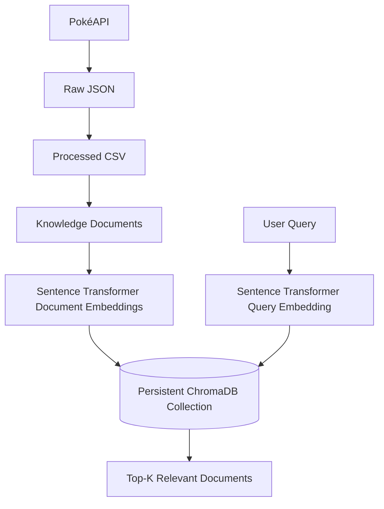

# Pokedex AI

## Overview

Pokedex AI is a local Pokémon knowledge-data pipeline. It collects generation-scoped data from PokéAPI, converts raw JSON into structured CSV files and knowledge documents, generates vector embeddings, and stores those vectors in a persistent ChromaDB collection.

The current implementation covers data preparation, persistent vector indexing, semantic retrieval, and context-grounded question answering. The language model is instructed to use retrieved knowledge only.

## Features

- Generation-scoped PokéAPI downloads with retries and resume support.
- CSV preprocessing for Pokémon, species, moves, and evolution chains.
- Six focused knowledge documents per Pokémon, plus move and evolution-chain documents.
- Batched embeddings generated with `all-MiniLM-L6-v2`.
- Persistent ChromaDB collection with duplicate-ID protection.
- Top-K semantic retrieval from a user query against the persistent collection.
- Concise answers generated with LangChain `ChatOllama` using retrieved context only.
- FastAPI endpoints for health checks and RAG questions.

## Tech Stack

- Python 3.12
- PokéAPI, Requests, and tqdm
- pandas
- Sentence Transformers
- ChromaDB
- LangChain `ChatOllama`
- Ollama
- FastAPI
- python-dotenv

## Project Architecture



### Module Interaction

```mermaid
flowchart LR
	CONFIG[config.py] --> COLLECT[data_loader.py]
	COLLECT --> RAW[Raw JSON]
	RAW --> PREPROCESS[preprocessor.py]
	PREPROCESS --> CSV[Processed CSV]
	CSV --> GENERATE[document_generator.py]
	GENERATE --> DOCS[Knowledge Documents]
	DOCS --> EMBED[embedder.py]
	EMBED -->|Embedding records in memory| STORE[vector_store.py]
	STORE --> DB[(data/chroma_db)]
	USER[User query] --> RETRIEVE[retriever.py]
	RETRIEVE -->|Query embedding| MODEL[Cached Sentence Transformer]
	MODEL --> RETRIEVE
	RETRIEVE --> DB
	DB -->|Top-K documents| RETRIEVE
	RETRIEVE --> RAG[rag.py]
	RAG --> PROMPT[prompts.py]
	PROMPT --> LLM[ChatOllama via llm.py]
	LLM --> ANSWER[Grounded answer]
```



## Folder Structure

```text
pokedex-ai-rag/
├── AGENTS.md
├── .env.example
├── .gitignore
├── README.md
├── requirements.txt
├── backend/
│   ├── app.py
│   ├── api.py
│   ├── config.py
│   ├── schemas.py
│   ├── data_loader.py
│   ├── preprocessor.py
│   ├── document_generator.py
│   ├── embedder.py
│   ├── vector_store.py
│   ├── llm.py
│   ├── prompts.py
│   ├── rag.py
│   ├── recommender.py
│   └── retriever.py
├── frontend/
│   └── app.py
└── data/
	├── raw/
	│   ├── pokemon/
	│   ├── species/
	│   ├── moves/
	│   └── evolution_chains/
	├── processed/
	│   ├── pokemon.csv
	│   ├── species.csv
	│   ├── moves.csv
	│   └── evolution_chains.csv
	├── documents/
	│   ├── pokemon_documents.json
	│   ├── move_documents.json
	│   └── evolution_documents.json
	└── chroma_db/
```

The files `recommender.py` and `frontend/app.py` are present as placeholders.
`backend/app.py` currently exposes only welcome and health endpoints; it is
separate from the command-line RAG workflow.

## Data Pipeline

Pokémon species IDs come from the selected PokéAPI generation. The pipeline downloads the corresponding species and Pokémon records, then follows references in those records to find the required moves and evolution chains.

The preprocessor creates one CSV per resource type. The document generator combines Pokémon and species data and creates separate document sets for Pokémon, moves, and evolution chains. The embedder converts document content into vectors in batches. The vector-store module passes those vectors and their source data to ChromaDB.

## Installation

Use Python 3.12 and install the dependencies from the project root:

```powershell
python -m venv .venv
.\.venv\Scripts\Activate.ps1
python -m pip install -r requirements.txt
```

## Project Setup

Create the local environment file from the example:

```powershell
Copy-Item .env.example .env
```

Edit `TARGET_GENERATION` to select the generation for data collection. The other environment settings and their current usage are listed below.

Ollama must be running with the model named by `OLLAMA_MODEL` available locally. With the default setting, download it with `ollama pull llama3`.

## Environment Variables

| Variable | Example | Current use |
| --- | --- | --- |
| `TARGET_GENERATION` | `1` | Selects the generation used by the data loader. |
| `POKEAPI_BASE_URL` | `https://pokeapi.co/api/v2` | Base URL used for API requests. |
| `POKEAPI_TIMEOUT` | `10` | Request timeout in seconds. |
| `POKEAPI_MAX_RETRIES` | `3` | Maximum attempts for a failed API request. |
| `EMBEDDING_MODEL` | `all-MiniLM-L6-v2` | Defined in config; the embedder currently uses its `MODEL_NAME` constant. |
| `CHROMA_DB_PATH` | `data/chroma_db` | Defined in config; the vector-store module currently uses this project-relative path directly. |
| `TOP_K` | `5` | Number of documents retrieved for each query. |
| `OLLAMA_MODEL` | `llama3` | Ollama model used by `ChatOllama`. |

## Running the Project

Run each stage from the project root, in order:

```powershell
python -m backend.data_loader
python -m backend.preprocessor
python -m backend.document_generator
python -m backend.embedder
python -m backend.vector_store
python -m backend.retriever
python -m backend.rag
```

The embedder command reports the embedding summary without saving vectors. The vector-store command generates embeddings again and persists them in ChromaDB. The retriever displays top matches; the RAG command prompts for a question and prints a context-grounded answer.

## Data Collection

`backend/data_loader.py` starts at the PokéAPI Generation endpoint. It saves each resource as an individual JSON file under `data/raw/`, skips existing valid files, and retries failed requests. Move IDs are collected from Pokémon data; evolution-chain IDs are collected from species data. Only referenced moves and chains are downloaded.

## Data Preprocessing

`backend/preprocessor.py` reads the raw JSON files and writes `pokemon.csv`, `species.csv`, `moves.csv`, and `evolution_chains.csv` to `data/processed/`. It extracts the project’s selected fields, normalizes text, selects English descriptions/effects, flattens evolution stages, and removes duplicate rows.

## Knowledge Document Generation

`backend/document_generator.py` merges Pokémon and species rows by ID and creates six focused JSON documents per Pokémon: overview, types, abilities, base stats, physical information, and learnable moves. Each title and content block is grouped under the Pokémon name, with descriptive IDs such as `pokemon_pikachu_types`. Normal and hidden abilities are read from the corresponding raw Pokémon JSON because the processed CSV does not retain the hidden-ability flag. Moves and evolution chains remain unchanged.

Separating fields into smaller documents helps semantic search return the relevant topic instead of a Pokémon’s entire move list and profile. This keeps irrelevant text out of retrieved results and reduces the context that a future answer-generation stage would need to consume.

## Embedding Generation

`backend/embedder.py` loads the three knowledge-document files and embeds each document’s `content` using `all-MiniLM-L6-v2` with a batch size of 32. The resulting records keep their IDs, content, and metadata with each vector. Running this stage alone keeps vectors in memory; it does not save them.

## Vector Database (ChromaDB)

`backend/vector_store.py` uses ChromaDB’s `PersistentClient` at `data/chroma_db/` and creates or opens the `pokemon_knowledge` collection. It checks IDs before insertion and skips records already in the collection. List-valued metadata is converted to comma-separated text for storage.

## Semantic Retrieval

`backend/retriever.py` embeds a user query with the cached Sentence Transformer model, searches the persistent ChromaDB collection, and returns the top `k` matches with content, metadata, and a similarity score.

```text
User Query
	↓
Query Embedding
	↓
ChromaDB Similarity Search
	↓
Top-K Relevant Documents
```

Run an interactive query from the project root with `python -m backend.retriever`. The default result count is `TOP_K` (5). ChromaDB uses L2 distance for this collection; the returned score is `1 / (1 + distance)`, so higher scores indicate closer results.

## RAG Pipeline

`backend/rag.py` retrieves the configured top five documents, builds a concise prompt from their titles and content, and sends it to `ChatOllama` through LangChain. The model is instructed to answer only from that context; when retrieval is empty, the pipeline returns `I couldn't find that information in the knowledge base.`

```text
User → Retriever → Prompt → LangChain → Ollama → Answer
```

Run the interactive pipeline from the project root with `python -m backend.rag`. Retrieval scores and document details are hidden unless `DEBUG` is enabled in `backend/rag.py`.

## API

Start the FastAPI server from the project root:

```powershell
uvicorn backend.api:app --reload
```

| Method | Endpoint | Purpose |
| --- | --- | --- |
| `GET` | `/` | Welcome message. |
| `GET` | `/health` | API service status. |
| `POST` | `/ask` | Return a context-grounded answer to a question. |

`POST /ask` accepts and returns:

```json
{
	"question": "What type is Pikachu?"
}
```

```json
{
	"question": "What type is Pikachu?",
	"answer": "Pikachu is an Electric type Pokémon."
}
```

Blank questions receive HTTP `422`. The interactive Swagger UI is available at `http://127.0.0.1:8000/docs`.

## Current Project Workflow

1. Collect Generation I resources from PokéAPI.
2. Convert raw JSON into four processed CSV datasets.
3. Generate six focused knowledge documents per Pokémon, plus move and evolution-chain documents.
4. Generate document-content embeddings.
5. Store the vectors and associated records in the persistent collection.
6. Embed a user query, search the collection, and return the top-k documents.
7. Build a context-only prompt, send it to Ollama through LangChain, and return the answer.
8. Expose the RAG pipeline through the FastAPI `/ask` endpoint.

## Example Project Output

Indexing the current datasets into a clean collection produces this summary:

```text
Collection: pokemon_knowledge
Pokemon Documents: 906
Move Documents: 592
Evolution Documents: 78
Total Indexed: 1576
Collection Count: 1576
Indexing Complete.
```

The vector-store stage only adds missing IDs, so it does not remove records from an older collection. The current local collection contains 1,576 records. If rebuilding after a document-format change, recreate the derived `data/chroma_db/` collection; do not delete the raw JSON, CSV, or knowledge-document source files. On later runs, existing IDs are skipped and `Collection Count` reports the stored total.

## Project Statistics

The following snapshot was calculated from the current local raw files, CSVs, knowledge documents, source tree, and persistent collection on 2026-10-15. Generated data and source counts can differ on another checkout or after rerunning the pipeline.

| Category | Metric | Value |
| --- | --- | ---: |
| Dataset | Pokémon downloaded | 151 |
| Dataset | Species downloaded | 151 |
| Dataset | Unique moves | 592 |
| Dataset | Evolution chains | 78 |
| Knowledge base | Pokémon documents | 906 |
| Knowledge base | Move documents | 592 |
| Knowledge base | Evolution documents | 78 |
| Knowledge base | Total knowledge documents | 1,576 |
| Embeddings | Model | `all-MiniLM-L6-v2` |
| Embeddings | Dimension | 384 |
| Vector store | Collection | `pokemon_knowledge` |
| Vector store | Current local indexed documents | 1,576 |
| Repository | Python source files | 15 |
| Repository | Backend modules | 14 |
| Repository | Approximate Python source lines | 1,635 |
| Repository | Implemented project phases | 9 |

## Future Improvements

- Expand the minimal FastAPI application beyond its current root and health endpoints.
- Build a Gradio interface for interacting with the project.
- Implement and connect the Pokémon recommendation module.

## License

No `LICENSE` file is currently present. The project’s reuse and distribution terms have not been specified.